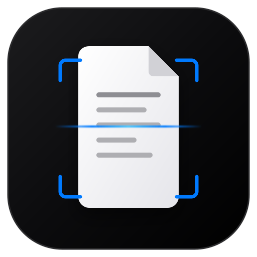

# ApexDoc Scanner 📄✨

> Minimal Apple-aesthetic, mobile-first document scanner and PDF maker that runs **100% inside your web browser**. Zero cloud uploads, 100% private, and works offline.



---

## 🌟 Highlights

- **🍏 Minimal Apple Look & Feel**: Designed according to Apple Human Interface Guidelines with frosted glass surfaces (`backdrop-filter: blur(28px)`), San Francisco / Inter typography, and iOS-style bottom sheets.
- **🔒 100% Private & In-Browser**: Camera capture, edge cropping, shadow removal filters, and PDF compilation run entirely in device memory. No photos are ever sent to an external server.
- **✈️ Works 100% Offline (PWA)**: Progressive Web App with Service Worker caching. Add to Home Screen on iOS or Android and scan documents with zero internet connection.
- **📐 4-Corner Perspective Warp**: Straightens skewed documents using mathematical projective homography. Includes a circular **magnifying loupe** hovering above your finger for pixel-perfect edge alignment.
- **✨ Professional Document Filters**:
  - **B&W Clean (Document Mode)**: Integral image adaptive thresholding that destroys dark room shadows and paper creases, delivering crisp laser-print black on pure white.
  - **Magic Color**: Background flattening with saturation boost for colored stamps, signatures, and logos.
  - **Grayscale**: High-contrast contrast-stretched monochrome.
  - **Original Photo**: Pure camera sensor output.
- **📑 Multi-Page PDF Compiler**: Reorder, rotate, add pages, and export to **A4**, **US Letter**, or **Auto-Fit** formats with customizable compression.
- **📲 Native System Share**: Direct integration with the Web Share API (Save to Apple Files, AirDrop, WhatsApp, Mail) with instant fallback to direct download.

---

## 🚀 Live Demo & Deployment

This project contains zero backend code and is ready for instant 1-click deployment on **GitHub Pages** or **Cloudflare Pages**.

### One-Click Deploy to GitHub Pages
1. Push this repository to GitHub.
2. In your repo: **Settings** > **Pages** > **Source** > choose **GitHub Actions**.
3. The included `.github/workflows/deploy.yml` will automatically build and publish your site!

### Deploy to Cloudflare Pages
1. Go to [Cloudflare Dashboard](https://dash.cloudflare.com/) > **Workers & Pages** > **Connect to Git**.
2. Select this repo and set:
   - Framework preset: `Vite`
   - Build command: `npm run build`
   - Output directory: `dist`
3. Click **Save and Deploy**.

---

## 🛠️ Local Development

```bash
# 1. Install dependencies
npm install

# 2. Run local dev server
npm run dev

# 3. Build optimized production bundle
npm run build
```

---

## 📚 Documentation

Detailed documentation is available in the [`docs/`](./docs/) directory:
- [Context & Vision](./docs/context.md) — Product philosophy and requirements
- [System Architecture](./docs/architecture.md) — Technical pipeline and homography math
- [Implementation Plan](./docs/implementation.md) — File mapping and code structure
- [Non-Coder Guide](./docs/non-coder-guide.md) — Plain-English explanation for non-technical users
- [Deployment Guide](./docs/deployment.md) — Step-by-step GitHub & Cloudflare deployment

---

## 📄 License
MIT License. Free to use and customize.
