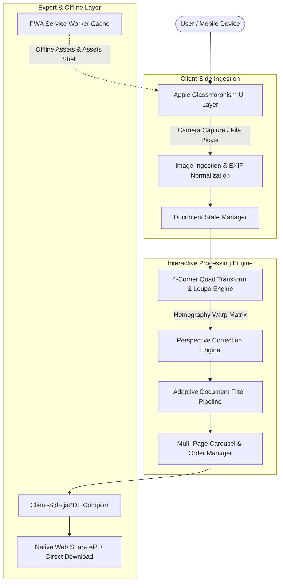

# System Architecture: ApexDoc Scanner (Minimal Apple Web Edition)

## 1. High-Level Architecture Overview

ApexDoc Scanner is built with a zero-backend, pure client-side architecture. All computation—from perspective warping and pixel-level document filtering to PDF document compilation—executes strictly within the client device's browser thread and Web Worker / Canvas pipeline.



---

## 2. Key Architectural Components

### A. Apple-Inspired UI Layer
- **Design Tokens**: Standardized CSS custom properties for Apple dynamic blur levels, semantic colors (System Gray, System Blue, Dark translucent glass, Card elevation), and spring animations (`cubic-bezier(0.16, 1, 0.3, 1)`).
- **Responsive Layout**: Designed mobile-first for portrait orientation with ergonomic one-thumb touch targets (minimum 44x44pt Apple touch guidelines) and responsive fluid scaling on desktop tablets/PCs.
- **Glassmorphism & Modals**: CSS backdrop filters, floating bottom toolbar, and iOS-style drag/dismissible bottom action sheets.

### B. Perspective Warp & Quad Transform Engine
Warping a tilted photo of a document into a flat, upright rectangle requires **Projective Homography**:
1. **Coordinate System**:
   - Source Quad: 4 draggable points $(x_0, y_0), (x_1, y_1), (x_2, y_2), (x_3, y_3)$ defining the paper corners in raw image coordinates.
   - Destination Quad: Upright rectangle $(0, 0), (W, 0), (W, H), (0, H)$, where $W$ and $H$ are calculated from the maximum euclidean edge lengths.
2. **Homography Solver**:
   - Solves the 8-parameter 2D projective transformation matrix $H$:
     $$\begin{bmatrix} x' \\ y' \\ 1 \end{bmatrix} \sim H \begin{bmatrix} x \\ y \\ 1 \end{bmatrix}$$
   - Uses Gaussian elimination to compute matrix coefficients directly in lightweight JavaScript without bulky external libraries.
3. **Warp Rendering**:
   - High-performance Canvas rendering or piecewise affine triangle subdivision to ensure sub-100ms render speeds even on mobile phones.

### C. Touch Magnification Loupe System
- When a user touches and drags any of the 4 corner handles, an Apple-style circular magnifying loupe appears **70px directly above the touch coordinate**.
- Renders a 2.5x magnified view of the raw image with an ultra-thin crosshair target, ensuring the user's thumb never blocks the exact edge of the paper.

### D. Adaptive Document Filter Pipeline
Executed on HTML5 `ImageData` pixel buffers:
1. **B&W Clean (Document Mode)**:
   - Uses local adaptive thresholding (integral image window calculation).
   - Dynamically calculates the average neighborhood luminance to separate ink from paper, completely stripping away shadows, wrinkles, and background coloration while preserving high-contrast text.
2. **Magic Color**:
   - Analyzes pixel RGB distributions, calculates local background illumination, normalizes white balance, and amplifies text saturation and sharpness.
3. **Grayscale**:
   - Applies ITU-R BT.601 luminance weights ($Y = 0.299R + 0.587G + 0.114B$) coupled with dynamic range stretching.
4. **Original Photo**:
   - Preserves natural camera sensor output with optional subtle clarity sharpening.

### E. Multi-Page Document State Machine
- Manages an ordered list of `ScannedPage` objects:
  ```typescript
  interface ScannedPage {
    id: string;
    originalImage: Blob | HTMLImageElement;
    quadPoints: [{x: number, y: number}, ...];
    rotation: 0 | 90 | 180 | 270;
    activeFilter: 'bw' | 'magic' | 'grayscale' | 'original';
    processedCanvas: HTMLCanvasElement;
    thumbnailUrl: string;
  }
  ```
- Supports adding, rotating, reordering, and deleting pages with instant thumbnail preview.

### F. Pure Client-Side PDF Compiler (`jsPDF`)
- Bundles all processed pages into a multi-page PDF document.
- Supports page formatting:
  - **A4** (standard international document)
  - **US Letter** (standard US format)
  - **Auto-Fit** (matches exact aspect ratio of each scanned page)
- Handles JPEG image compression settings (High Quality vs. Compact Size).
- Interacts with the `navigator.share()` Web Share API for native iOS / Android system sharing (Save to Apple Files, AirDrop, Gmail, WhatsApp).

### G. Progressive Web App (PWA) & Offline Shell
- **`sw.js` (Service Worker)**: Intercepts network fetch events and serves cached static HTML, CSS, JavaScript, fonts, and icons from the Cache API.
- **`manifest.webmanifest`**: Provides native app metadata, icons, standalone display mode, and theme color for iOS and Android homescreens.

---

## 3. Deployment Pipeline


- **Cloudflare Pages / GitHub Pages**: 100% static hosting, free tier with unlimited bandwidth, custom domain support, and SSL out-of-the-box.
